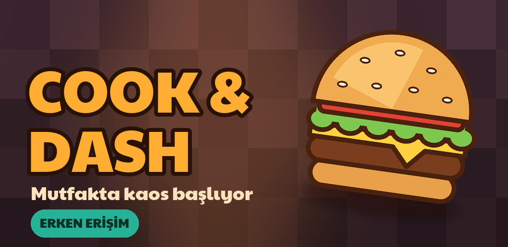
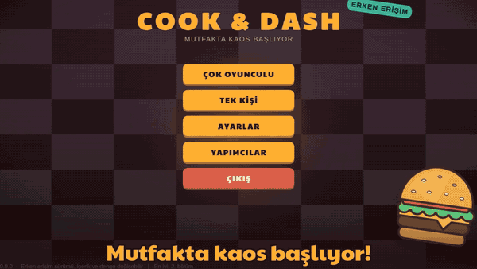
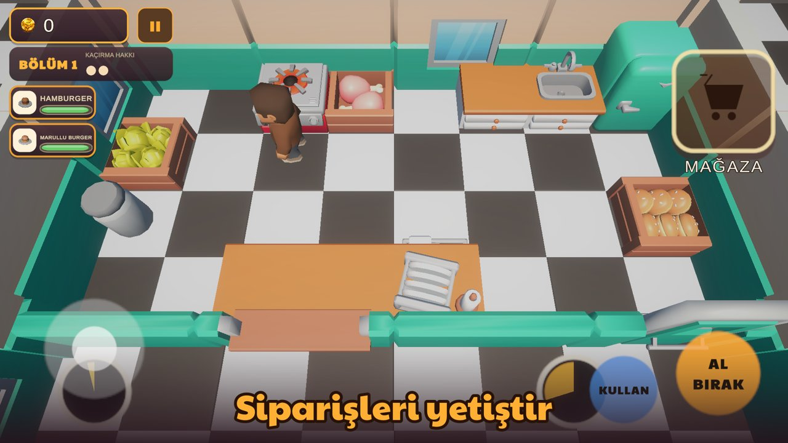
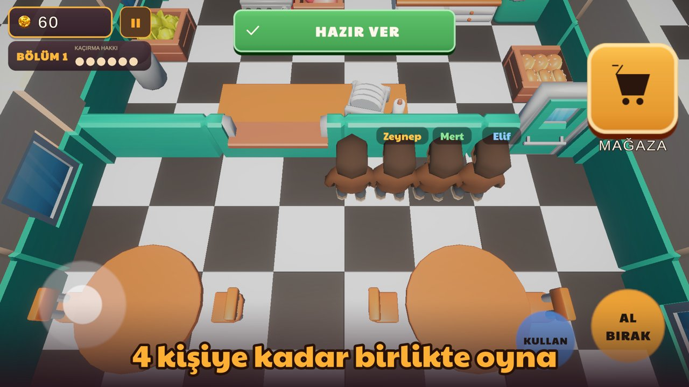
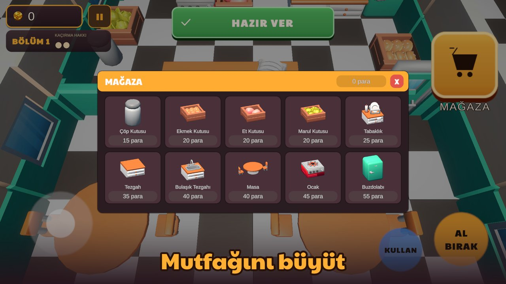
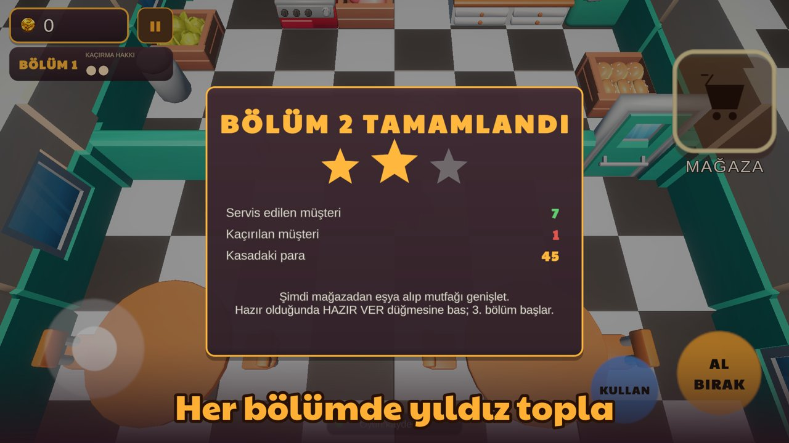
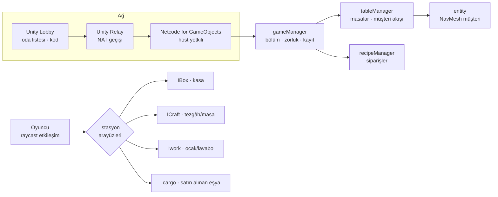

# 🍔 Cook & Dash Online

**Arkadaşlarınla aynı mutfakta hamburger yetiştirdiğin, 1–4 oyunculu çevrimiçi bir restoran oyunu. Unity 6 ve Netcode for GameObjects ile geliştirdiğim, Google Play'e hazırlanan erken erişim oyunum.**

## Oyun
Müşteriler gelir, siparişler yağar, mutfak karışır. Oyunun akışı şöyle:
- Malzemeyi kasasından alırsın, tezgâhta hazırlarsın, köfteyi ocakta pişirirsin.
- Yemeği tabağa koyup siparişi veren masaya süre dolmadan götürürsün.
- Kirli tabakları yıkamazsan temiz tabak kalmaz.
- Bölüm aralarında kazandığın parayla yeni tezgâh, ocak, masa ve kasa alıp mutfağını kendi düzenine göre kurarsın.
- Bir bölümde çok müşteri kaçırırsan oyun biter.

| | |
|---|---|
|  |  |
|  |  |

## Özellikler
- **1–4 oyuncu**
  - Tek kişilik mod çevrimdışı oynanır.
  - Çok oyunculu modda Unity **Lobby** ile oda kurulur, kodla katılınır.
  - **Relay** ile NAT arkasından internet üzerinden oynanır.
- **Sunucu yetkili ağ mimarisi:** Oyun durumu host'ta tutulur, istemciler RPC ve NetworkVariable ile senkronize edilir. Sahiplik tabanlı hareket ve animasyon senkronu kullanılır.
- **Müşteri davranışı:** Müşteriler NavMesh ile restorana gelir, boş masaya oturur, sipariş verir, sabırları tükenince ayrılır. NavMesh, oyuncunun kurduğu düzene göre çalışma anında yeniden hesaplanır.
- **İstasyon sistemi:** `IBox`, `ICraft`, `Iwork` ve `Icargo` arayüzleriyle tanımlanan istasyonlar var: malzeme kasası, tezgâh, ocak, lavabo, tabaklık ve masa. Yeni istasyon eklemek bir arayüzü uygulamak kadar kolay.
- **Tarif sistemi:** Enum tabanlı malzeme, tarif ve tabak durum makinesi kullanılıyor (alt ekmek → köfte → marul → kapak).
- **Oyuncu sayısına göre zorluk:** Müşteri sayısı, gelme sıklığı ve kaçırma hakkı ekibin büyüklüğüne göre ayarlanır.
- **Otomatik kayıt:** Bölüm aralarında mutfağın düzeni, açılmamış kargolar ve para kaydedilir; "Devam et" ile kalınan yerden sürdürülür.
- **Sonradan katılma:** Bölüm aralarında odaya yeni oyuncu girebilir, düşen oyuncu geri dönebilir.
- **Mobil:** Dokunmatik kontroller (kayan joystick ve iki büyük düğme), Türkçe ve İngilizce dil desteği. Android hedef API 36 (ARM64 + ARMv7).

## Mimari

## Nasıl denenir
[Releases](../../releases) sayfasında iki dosya var:
- **Windows:** `CookDash-0.9.0-Windows.zip`. Zip'i açıp `CookDash.exe` ile başlat. Tek kişilik mod internetsiz çalışır. Aynı bilgisayarda iki kopyayla çok oyunculu deneme için `CookDash.exe -profile oyuncu1` ve `-profile oyuncu2` ile aç.
- **Android:** `CookDash-0.9.0.apk`. Telefona kopyalayıp kur ("bilinmeyen kaynaklar" izni gerekir).

## Kod örnekleri
Oyunun kaynak kodu kapalıdır. Mimariyi gösteren birkaç parça [`showcase/`](showcase) klasöründe:
- [`Inventory/Interface`](showcase/Inventory/Interface): istasyon sözleşmeleri.
- [`Box/stoveBox.cs`](showcase/Box/stoveBox.cs) ve [`Box/washingBox.cs`](showcase/Box/washingBox.cs): ağ senkronlu, zamanlı istasyonlar.
- [`Entity/entity.cs`](showcase/Entity/entity.cs): sunucuda çalışan NavMesh müşteri davranışı ve istemci tarafı yumuşatma.
- [`Manager/recipeManager.cs`](showcase/Manager/recipeManager.cs): sipariş üretimi.

---
© Ahmet Emin Arslanbaş — Tüm hakları saklıdır. Kaynak kod paylaşılmamıştır; satın alınan asset paketleri kendi lisanslarına tabidir.
